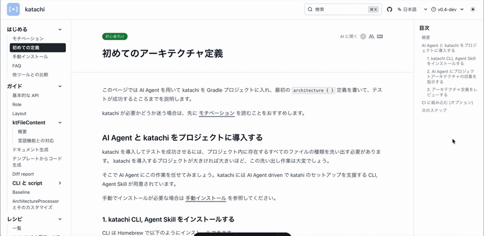

# feedback-mode

アプリに **debug ビルド限定のフィードバックモード** を組み込み、溜まったフィードバックを Claude Code に消化させる。

[](./feedback-mode-demo.mp4)

Astro の docs サイトで、見出しを選んでコメントを書いて送るまで（約 50 秒。[動画（mp4）](./feedback-mode-demo.mp4)）。

## インストール

```sh
gh skill install tbsten/skills feedback-mode
```

## 概要

フィードバックモードでは、動いているアプリ上で画面の部品を選んでコメントを書く。アプリが文脈（どの部品か・画面の状態・直近のログ・
選んだ部品を枠で囲んだスクリーンショット）を自動で付けて、**1 件 = 1 記録**としてフィードバック置き場（Inbox）に保存する。
Claude Code は置き場を読み、記録を実装・調査・設計に振り分けてサブエージェントに任せ、対応済みの記録を archive して報告する。

references は **タイミング別** に分け、setup はさらに **プラットフォームごとの adapter** に分けた。起動時にタイミングを判定（`scripts/detect.sh`）し、その入口だけを読む。

| 判定 | 状況 | 読むもの |
|---|---|---|
| `setup` | 置き場も配線も無い | `references/setup/setup.md` と adapter のファイル **1 枚**（例: `setup/web/astro.md`） |
| `partial` | 配線はあるが記録が無い | `setup.md` の一部の手順 → loop |
| `loop` | 置き場がある | `references/loop/`（消化ループ）だけ |
| `review` | `review/` だけがある | `references/review/`（agent の指摘を人に答えてもらう側）だけ |

共通仕様（満たすべき機能の必須 / optional・ディレクトリと記録の形・Sink と通信）は `references/spec/` にあり、手順の中で指されたところだけを読む。
必要なところしか読まないので、関係のない指示がコンテキストに入らない。

逆向き（agent → 人）の道具も持つ。

| 向き | 道具 | 中身 |
|---|---|---|
| agent → 人 | **Review** | agent がレビュー・チェックで見つけた指摘を `<Inbox>/review/*.md` に書き、人は画面の印と popup（または チャット）で読んで「解決済みにする / 直さない / 直してもらう / 人が足した選択肢」で答える。指摘には `impact`（ユーザ影響の有無）と `recommend`（ボタンごとの推奨度）を付ける。cli は `scripts/review.mjs` |
| 人の答え → 次の回 | **判断の記録** | 「直さない・このまま・後で・方針」を git の `.claude/feedback-decisions/` に溜め、次の回は照らしてから指摘を出す（同じことを二度聞かない）。`scripts/decisions.py` |
| 人 → agent（agent が作った HTML） | **静的な HTML のフィードバック** | agent が作る 1 枚のレポート・チェックリストに、人が項目を選んでコメント（Shift で複数・引用・書きかけ保持）し、回答とまとめてコピーしてチャットに貼る。宛先は HTML の中の JSON の場所 |

## 使うべきタイミング

- Web（DOM・React・Astro）・Desktop（Electron / Tauri）・モバイル（Android の Compose・Compose Multiplatform・iOS の SwiftUI）アプリで、画面・状態・ログ・スクリーンショット付きのフィードバックを Claude Code の作業に流したい
- フィードバックの保存先（ローカルのファイル・開発機への HTTP 受け口・Issue トラッカー・クラウドストレージ）を変えたい
- フォルダに溜まったフィードバックを、サブエージェントで一通り対応させたい
- すでに debug menu・開発者向け画面があり、そこにフィードバックの入口を足したい
- agent の指摘（レビュー・リリース前チェック）が多く、表ではなく場所の上で人に読んでもらい、ボタンで答えてもらいたい
- 前の回に「直さない」と答えた指摘を、次の回に聞き直されたくない
- agent が作る HTML のレポートに、人がその場でコメントして返せるようにしたい

## 設計方針

- **プラットフォームは adapter で差し替え**: 環境で変わるのは決まった差し込み口（入口・部品の選択・名前・操作を止める・文脈・ログ・スクショ・送り方・本番除外・Agent への案内）だけ。受け口・Sink・記録の形は共通なので、新しい環境は adapter のファイルを 1 枚埋めれば足せる
- **Sink による抽象化**: 置き場を `Sink` インターフェース（`putAttachments` / `putEntry` / `list` / `read` / `archive`）にした。
  同梱の実装はローカルのファイル・メモリ（テスト用）・HTTP。Issue トラッカー・クラウドストレージは概要のみ
- **debug ビルド限定**: 配線はビルド時に消す（DCE + 動的 import、`#if DEBUG`、debug source set、別 entrypoint など）。実行時の `enabled` は保険で、
  本番成果物を script で grep して確認する
- **既存のデバッグ基盤に乗る**: debug menu・dev panel があれば、新しい入口やガードを作らず、そこに 1 項目足す
- **ログ基盤は別タスク**: フィードバックモードは `getRecentLogs` の差し込み口からログを読んで添付するだけ

## 同梱物

| パス | 役割 |
|---|---|
| `SKILL.md` | 全体像・タイミングの判定・同梱テンプレートの一覧 |
| `references/setup/` | `setup.md`（共通の手順・debug 限定・既存のデバッグ基盤・ログ・チェックリスト）、`adapter.md`（差し込み口・adapter の一覧・作り方）、環境ごとの adapter: `web/`（dom・react・astro・single-html と Web の optional 機能の作り方）・`desktop/`（electron・tauri）・`mobile/`（common・android・kmp・ios） |
| `references/loop/` | 消化ループ（運用ルール・分類・履歴・報告）・サブエージェントのプロンプト・全体チェック・落とし穴 |
| `references/review/` | Review の形・流れ・ボタン・cli、UI の決まり、判断の記録 |
| `references/spec/` | `features.md`（必須 / optional）・`data.md`（ディレクトリ・記録・メモ・履歴）・`transport.md`（Sink の契約・Transport・受け口の API） |
| `assets/templates/core/`・`core-ts/` | 共通のコア: Sink の契約・採番・redact・記録の組み立て・ファイル / メモリ / HTTP の Sink・HTTP の受け口・テスト |
| `assets/templates/adapters/` | 環境ごとのひな形: `web/dom`・`web/astro`・`web/single-html`・`desktop/electron`・`mobile/compose`・`mobile/android`・`mobile/kmp`・`mobile/ios` |
| `assets/templates/data/`・`review/` | 記録・メモ・Review の指摘・判断の JSON スキーマと例 |
| `scripts/` | `detect.sh`（タイミングの判定）・`copy-core.sh`（コアのコピーとテスト）・`check-no-feedback-in-prod.sh`（本番の成果物の検査）・`check-android-release.sh` / `check-ios-release.sh`（release の APK・`.app` の権限と設定も見る）・`watch-inbox.mjs`（Inbox を見張り、新しい記録ごとに知らせる・コマンドを実行する）・`single-html.mjs`（1 枚の HTML を作る・データを読み書きする。e2e も同じ場所）・`review.mjs`（Review の cli）・`decisions.py`（判断の記録） |

## 環境ごとの対応表

| 機能 | DOM | React + Vite | Astro | Electron | Tauri | 1 枚の HTML | Android（Compose） | CMP（Android・iOS・Desktop・Web） | iOS（SwiftUI） |
|---|---|---|---|---|---|---|---|---|---|
| 必須の通し（入る → 選ぶ → 送る → 記録ができる・下にクリックが届かない・本番の検査） | ✅ | ✅ | ✅ | ✅ | ✅ | ✅ | ✅ | ✅ | ✅ |
| 入口 | ホットキー・既存の dev panel から `enter()` | 同左 | Dev Toolbar のアプリ | 開発メニューの項目 | ホットキー | 右下のボタン | 画面の隅の「FB」ボタン | 同左 | 同左 |
| 送り方（Transport） | HTTP | HTTP | toolbar のメッセージ | IPC | HTTP | クリップボード | HTTP | HTTP | HTTP |
| O1 スクリーンショット | ✅ html2canvas | ✅ html2canvas | 📝 modern-screenshot | ✅ `capturePage` | — | — | ✅ graphics layer | ✅ graphics layer | ✅ `drawHierarchy` |
| O2 下書き | 🧩 | 🧩 | 📝 | 🧩 | 🧩 | ✅ | — | — | — |
| O3 複数選択 | — | — | 📝 | — | — | ✅ | — | — | — |
| O4 テキストの選択 | — | — | 📝 | — | — | ✅ | — | — | — |
| O5 ページ全体 | — | — | 🧩 | — | — | ✅ | 🧩 | 🧩 | — |
| O6 場所の手がかり | ✅ CSS セレクタ | ✅ CSS セレクタ | ✅ XPath・セレクタ | ✅ CSS セレクタ | ✅ CSS セレクタ | ✅ JSON の場所 | — | — | — |
| O7 popover | — | — | ✅ | — | — | ✅ | — | — | — |
| O8 スマホ幅 | — | — | ✅ | — | — | ✅ | — | — | — |
| O9 テーマ追従 | — | — | ✅ | — | — | 🧩 | — | — | — |
| O10 メモ | — | — | 📝 | — | — | — | — | — | — |
| O11 オプションの記憶 | 🧩 | 🧩 | — | 🧩 | 🧩 | — | — | — | — |

✅ ひな形にコードがあり、その環境で動かして確かめた　🧩 ひな形にコードはあるが、その機能はその環境で動かしていない　📝 作り方だけ（コードは無い。実際の運用で使った作り方）　— 無い

CMP の Desktop は、ウィンドウを人が操作するところまでは確かめていない（同じ画面を UI テストで動かして送った）。モバイルの実機（USB の Android・iOS）も未確認。

機能の中身は `references/spec/features.md`、各環境で何の版をどう確かめたかは各 adapter のファイルの冒頭。

## 成熟度と既知の制約

status は **Experimental**。確認済み: コア（メモリ・ファイル・HTTP の Sink に対する `node:test` 36 件 + skip 1 件）、TypeScript 版のコア（vitest 32 件）、`review.mjs`（`node:test` 19 件）、`decisions.py`（unittest 21 件）、`watch-inbox.mjs`（`node:test` 8 件）。adapter は、ひな形をそのままコピーした最小アプリを実際に動かして確かめた: DOM と React 19 + Vite 7（ヘッドレスの Chromium。html2canvas のスクショも）、Astro 7（Starlight の実サイトと最小プロジェクト）、Electron 38（xvfb + Playwright の `_electron`）、Tauri 2（Linux の xvfb + tauri-driver）、Android の Compose（エミュレータ API 36.1）、Compose Multiplatform（Android エミュレータ・iOS シミュレータ・wasmJs の Chrome。Desktop は UI テストで 1 件送るまで）、iOS の SwiftUI（iOS 26.2 シミュレータ）。USB の Android 実機と iOS 実機はまだ確かめていない。どれも本番の成果物を `check-no-feedback-in-prod.sh` で検査した。
実際に動かしたものだけを載せている。各 adapter のファイルの冒頭に、何の版で何を確かめたかを書いてある。リリース前には必ず成果物を検査すること。
