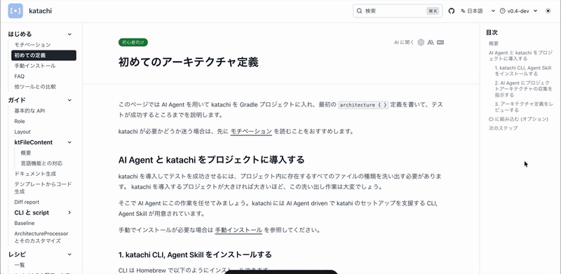

# feedback-mode

Build a **debug-only feedback mode** into your app, and let Claude Code triage the feedback it collects.

[](./feedback-mode-demo.mp4)

Picking a heading on an Astro docs site, writing a comment and sending it (about 50 s; [video (mp4)](./feedback-mode-demo.mp4)).

> The skill body is written in Japanese. This page is an English overview.

## Install

```sh
gh skill install tbsten/skills feedback-mode
```

## Overview

In the feedback mode, a tester (or you) selects a UI part in the running app and writes a comment.
The app attaches context automatically (which part, the screen state, recent logs, a screenshot with the
selected part outlined) and stores **one record per feedback** in a feedback inbox. Claude Code then reads the inbox,
splits the records into implement / investigate / design work for subagents, archives the handled ones, and reports.

References are split **by timing**, and setup is split **by platform adapter**. On start the skill decides the timing (`scripts/detect.sh`) and reads only that entry:

| Verdict | Situation | What is read |
|---|---|---|
| `setup` | no inbox, no wiring | `references/setup/setup.md` plus **one** adapter file (e.g. `setup/web/astro.md`) |
| `partial` | wiring but no records | a few steps of `setup.md`, then the loop |
| `loop` | an inbox exists | only `references/loop/` (triage loop) |
| `review` | only `review/` exists | only `references/review/` (a human answers the agent's findings) |

Shared specs live in `references/spec/` (required / optional features, directory and record formats, Sink and transport) and are read only where a step points to them.
Only one side is read, so unrelated instructions never enter the context.

It also covers the other direction (agent → human):

| Direction | Tool | What it does |
|---|---|---|
| agent → human | **Review** | The agent writes review / check findings to `<Inbox>/review/*.md`; a human reads them as marks and popups on the page (or in chat) and answers with buttons: resolved / won't fix / send as feedback / buttons the human added. Each finding carries `impact` (does it affect users) and `recommend` (a 0–10 score per button). CLI: `scripts/review.mjs` |
| human's answer → next run | **Decisions** | "Won't fix / as intended / later / policy" answers are kept in git (`.claude/feedback-decisions/`) and checked before the next run reports findings, so the same question is never asked twice. `scripts/decisions.py` |
| human → agent (an HTML the agent made) | **Static HTML feedback** | On a single-file report or checklist the agent generates, the human picks items and comments (Shift for several, quotes, drafts kept), then copies all comments together with answers and pastes them into the chat. Targets are paths into the JSON embedded in the HTML |

## When to use

- You develop a web (DOM / React / Astro), desktop (Electron / Tauri), or mobile (Android Compose / Compose Multiplatform / iOS SwiftUI) app and want
  in-app feedback that carries screen, state, logs, and screenshots into a Claude Code workflow
- You want to change where feedback is stored (local files, an HTTP receiver on a dev machine, an issue tracker, cloud storage)
- Feedback has piled up in a folder and you want Claude Code to work through it with subagents
- You already have a debug menu / dev panel and want to hang the feedback entry off it
- The agent produces many findings (reviews, pre-release checks) and you want a human to read them in place and answer with a button, not in a table
- You do not want to be asked again next run about a finding you already declined
- You want people to comment directly on an HTML report the agent generated

## Design policies

- **Platform adapters**: only a fixed set of slots changes per environment (entry, pick, name, block, collect, logs, capture, transport, exclude, pointer). The receiver, Sink and record format stay shared, so adding a platform means filling one adapter file
- **Sink abstraction**: the inbox is a `Sink` interface (`putAttachments` / `putEntry` / `list` / `read` / `archive`).
  Implementations shipped: local files, memory (tests), HTTP. Issue tracker and cloud storage are outlined only
- **Debug builds only**: wiring is removed at build time (DCE + dynamic import, `#if DEBUG`, debug source set,
  separate entrypoint, ...), with a runtime `enabled` guard as insurance, and a script greps the production artifact
- **Reuse the existing debug infrastructure**: if the app already has a debug menu / dev panel, add one entry there
  instead of creating a new entry point or guard
- **Logging is a separate task**: the feedback mode only reads logs through a `getRecentLogs` hook and attaches them

## Contents

| Path | Role |
|---|---|
| `SKILL.md` | Overview, timing decision, list of bundled templates |
| `references/setup/` | `setup.md` (common steps, debug-only wiring, existing debug infra, logging, checklist), `adapter.md` (slot list, adapter list, how to add one), and per-platform adapters: `web/` (dom, react, astro, single-html + Web optional features), `desktop/` (electron, tauri), `mobile/` (common, android, kmp, ios) |
| `references/loop/` | Triage loop (rules, classification, history, reporting), subagent prompts, full check, lessons |
| `references/review/` | Review format / flow / buttons / CLI, UI rules, decisions |
| `references/spec/` | `features.md` (required / optional), `data.md` (directories, records, memos, history), `transport.md` (Sink contract, transports, receiver API) |
| `assets/templates/core/` · `core-ts/` | Shared core: Sink contract, numbering, redact, record builder, file / memory / HTTP Sinks, HTTP receiver, tests |
| `assets/templates/adapters/` | Per-platform templates: `web/dom`, `web/astro`, `web/single-html`, `desktop/electron`, `mobile/compose`, `mobile/android`, `mobile/kmp`, `mobile/ios` |
| `assets/templates/data/` · `review/` | JSON Schema and examples of records, memos, review findings and decisions |
| `scripts/` | `detect.sh` (timing), `copy-core.sh` (copy core + run tests), `check-no-feedback-in-prod.sh` (grep production artifacts), `check-android-release.sh` / `check-ios-release.sh` (also check permissions and settings in release APKs / `.app`), `watch-inbox.mjs` (watch the Inbox and report or run a command for each new record), `review.mjs` (Review CLI), `decisions.py` (decisions) |

## Supported features by platform

| Feature | DOM | React + Vite | Astro | Electron | Tauri | Single HTML | Android (Compose) | CMP (Android, iOS, Desktop, Web) | iOS (SwiftUI) |
|---|---|---|---|---|---|---|---|---|---|
| Required flow (enter → pick → send → record saved, no click reaches the app, production check) | ✅ | ✅ | ✅ | ✅ | ✅ | ✅ | ✅ | ✅ | ✅ |
| Entry point | Hotkey, or `enter()` from an existing dev panel | Same | Dev Toolbar app | Dev menu item | Hotkey | Button at the bottom right | Corner “FB” button | Same | Same |
| Transport | HTTP | HTTP | Toolbar messages | IPC | HTTP | Clipboard | HTTP | HTTP | HTTP |
| O1 Screenshot | ✅ html2canvas | ✅ html2canvas | 📝 modern-screenshot | ✅ `capturePage` | — | — | ✅ graphics layer | ✅ graphics layer | ✅ `drawHierarchy` |
| O2 Drafts | 🧩 | 🧩 | 📝 | 🧩 | 🧩 | ✅ | — | — | — |
| O3 Multi-select | — | — | 📝 | — | — | ✅ | — | — | — |
| O4 Text selection | — | — | 📝 | — | — | ✅ | — | — | — |
| O5 Whole page | — | — | 🧩 | — | — | ✅ | 🧩 | 🧩 | — |
| O6 Location hints | ✅ CSS selector | ✅ CSS selector | ✅ XPath, selector | ✅ CSS selector | ✅ CSS selector | ✅ JSON path | — | — | — |
| O7 Popover | — | — | ✅ | — | — | ✅ | — | — | — |
| O8 Phone width | — | — | ✅ | — | — | ✅ | — | — | — |
| O9 Follow the page theme | — | — | ✅ | — | — | 🧩 | — | — | — |
| O10 Memos | — | — | 📝 | — | — | — | — | — | — |
| O11 Remember options | 🧩 | 🧩 | — | 🧩 | 🧩 | — | — | — | — |

✅ template code exists and was run on that platform　🧩 template code exists, but that feature was not run on that platform　📝 recipe only (no code; a recipe used in real use)　— not available

CMP Desktop was not operated by hand in a window (the same screen was driven by a UI test to send a record). Physical mobile devices (USB Android, iOS) are not verified.

See `references/spec/features.md` for what each feature does, and the top of each adapter file for the versions and how each platform was verified.

## Maturity and known limitations

Status is **Experimental**. Verified: the core (`node:test` 36 passing + 1 skipped over memory / file / HTTP Sinks), the TypeScript core (vitest 32), `review.mjs` (`node:test` 19), `decisions.py` (unittest 21), `watch-inbox.mjs` (`node:test` 8), and each adapter by actually running a minimal app with the templates copied as-is: DOM and React 19 + Vite 7 in headless Chromium (including html2canvas screenshots), Astro 7 (a real Starlight site and a minimal project), Electron 38 (Playwright `_electron` under xvfb), Tauri 2 (tauri-driver under xvfb on Linux), Android Compose (emulator, API 36.1), Compose Multiplatform (Android emulator, iOS simulator, wasmJs in Chrome; Desktop up to sending one record from a UI test), and iOS SwiftUI (iOS 26.2 simulator). Physical Android (USB) and iOS devices are not verified yet. Each run also checked the production artifact with `check-no-feedback-in-prod.sh`.
Only things that were actually run are included. Each adapter file starts with what was verified and on which versions. Always check the production artifact before release.
