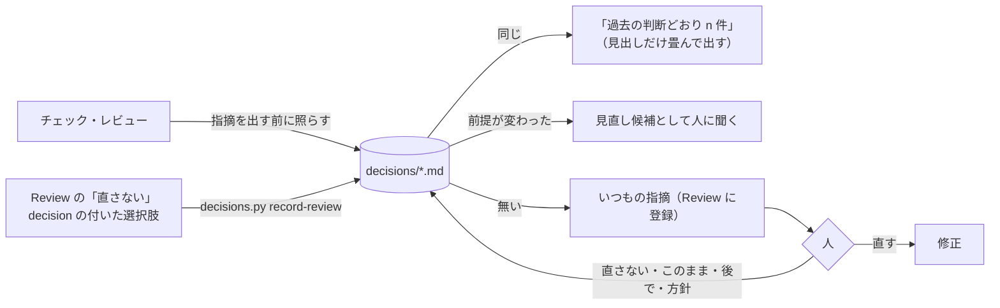

# 判断の記録（decisions）: 人が下した判断を溜めて、同じことを二度聞かない

Review（`review.md`）を何度も回す作業（リリース前チェック・定期のレビュー・docs の点検）では、前の回に人が「直さない」と答えた指摘を、次の回の agent がまた出してしまう。人が下した判断（直さない・このまま・後で・方針）を**リポジトリに**溜め、次の回は照らしてから指摘を出す。

【実績: Web 参照実装】リリース前チェックの 2 回目で、1 回目に答えた指摘を聞き直されたのがきっかけ。判断の置き場を作り、Review の「直さない」を写す script を足した。



## 1. 置き場

既定は `.claude/feedback-decisions/`（`--dir` か `$FEEDBACK_DECISIONS_DIR` で変える）。**git に入れる**（Review の置き場と違い、次の回・ほかの人の agent が読む）。ファイルは領域ごとに分けてよい（例: `docs.md`・`api.md`・`process.md`）。どれにも合わないものはいちばん近いファイルに書く。`README.md` は読まない。

## 2. 1 件の形

Review の指摘と同じ形にしてある（「直さない」をそのまま写せて、照合も `file` と `quote` でできる）。例: `assets/templates/review/decisions.example.md`。

```md
## 直さない: 指示語「これらは」
- decision: 直さない
- file: docs/guides/comparison.md
- quote: これらは **排他的とは限りません**
- rule: 指示語ではなく指すものを書く
- decided: 2026-11-10 release-check-01 #123
- by: 人（Review）

元の指摘の要約と、人の一言（理由）。理由が無ければ「人の一言: なし」。
```

- 見出しは `## <decision>: <元の指摘の見出し>`（照合に使うので言い換えない）。`[pN]` は付けない（判断は優先度と関係なく効く）。
- 見出しの直後に続く `- key: value` だけがメタ。

| キー | 中身 |
|---|---|
| `decision` | 必須。下の 4 つのどれか |
| `file` | 指摘の場所。`*`（1 階層）と `**`（階層をまたぐ）のグロブが使える。場所の無い判断（進め方の決まりなど）は省く |
| `quote` | その場所に含まれる文字列。照合と「まだ残っているか」の確かめに使う |
| `match` | `方針` で使う。指摘の見出しの正規表現。`file` に該当し見出しが合う指摘は同じとみなす（回ごとに言い方が揺れる種類の指摘をまとめて外す） |
| `rule` | 破っているとされたルール。番号は回ごとに振り直されるので要約も書く |
| `decided` | 必須。判断した日・回・チケットなど |
| `by` | 判断した人と場所（「人（Review）」「人（チャット）」） |
| `revisit` | `後で` は必須。見直す条件（「PR #65 のマージ後」「v2 の刷新」） |

| decision | 意味 | 次の回での扱い |
|---|---|---|
| `直さない` | 指摘は分かったうえで、この箇所は直さない | 同じ箇所・同じ指摘は出さない |
| `このまま` | 今の設計・挙動が意図どおり | 同じ宣言・同じ挙動への指摘は出さない |
| `後で` | 今回は直さない。`revisit` の条件で見直す | 条件を満たしていなければ出さない。満たしていれば見直し候補 |
| `方針` | ある種類の指摘をまとめて扱う決まり | `file` と `match`・本文の条件に該当する指摘は出さない |

**`方針` は人がそう言ったときだけ書く**。`直さない` が同じ形で何件も続いても、agent が勝手に `方針` にまとめない（まとめてよいかを人に聞く）。

## 3. script（`scripts/decisions.py`）

**読解・書き換え・再実装せず、そのまま実行する**（python3 3.10 以上・標準ライブラリだけ）。

```sh
D="python3 ${CLAUDE_SKILL_DIR}/scripts/decisions.py"
$D check [--root .]                                # 回の初めに。ERROR・GONE・LOST があれば NG と終了コード 1。REVISIT は見直す条件
$D match <review.md> [--drop] [--out <path>]       # 登録の前に。SAME（同じ）は --drop で外す。NEAR（quote だけ重なる）は外さず中身を読む
$D record-review <review.md> --decided "<日付 回>" [--to decisions.md] [--by "人（チャット）"]
                                                   # 「直さない」・decision の付いた選択肢を写す。直さないは REMOVE <id>（消す順）、人が足した選択肢は AGENT <id> <名前>
$D list [--decision 直さない]
# 共通: --dir <置き場>（$FEEDBACK_DECISIONS_DIR か .claude/feedback-decisions）/ --file-prefix <dir>（$FEEDBACK_FILE_PREFIX）
```

- `record-review` は何度回してもよい（同じ見出し・同じ file の判断があれば写さない。`match` の付いた `方針` に合う指摘も写さず id だけ出す）。「後で」は人の一言を `revisit` にする（無ければ「次の回で人に聞く」）。
- `REMOVE <id>` は**出た順に** `review.mjs remove <id>`（同じ見出しの `x`・`x-2` を前から消すと id がずれる）。
- `AGENT <id>	<名前>` は判断だけ写した指摘。その選択肢の `- agent:` の作業（チケットに積むなど）を済ませてから消す（`review.md` §8 の 3）。
- note の頭は、表示される全部のボタンの名前から**最長一致**で決めてから decision を見る（`PR`（decision あり）と `PR #65 待ち`（decision なし）があっても、後者の答えを `PR` と読まない）。
- 形の誤りがある判断（`check` の `ERROR`）は照合に使わない。直してから回す。

## 4. 照らし方（agent の判断が要るところ）

1. 回の初めに `check`。`ERROR` は形を直す。`GONE`（ファイルが無い）は判断も消す。`LOST`（quote が見つからない）は、その回に同じ趣旨の指摘が出なければ判断を消し、出たら見直し候補。`REVISIT` は条件を満たしたかを見る。
2. 各チェック（subagent に任せるならその subagent）に、関係するファイルの判断を渡す。
3. 指摘を Review に登録する前に `match --drop`。`SAME` は外れる。`NEAR` は中身を読んで決める。`このまま` の API は同じ宣言を指していれば同じ。`方針` は本文の条件で判断する。
4. 外した指摘は警告にしない。結果の末尾に「過去の判断どおり（n 件）」として見出しだけを畳んで並べる。
5. 同じ箇所だが**前提が変わった**とき（`revisit` が満たされた・指摘が判断のときより重い・箇所が書き換わって判断が合わない）は、前の判断と一緒に「見直し候補」として人に聞く。

## 5. 書き足し方

- 人がチャット・レポートで「直さない」「このまま」「後で」「こういう方針で」と答えたら、**その回のうちに**書き足す（手で書くか、Review の指摘に `resolve --note "直さない: <理由>"` をしてから `record-review`）。修正があればその変更と一緒にコミットする。
- 判断を覆すとき（「やっぱり直す」）は、その判断を消す。履歴は git に残る。
