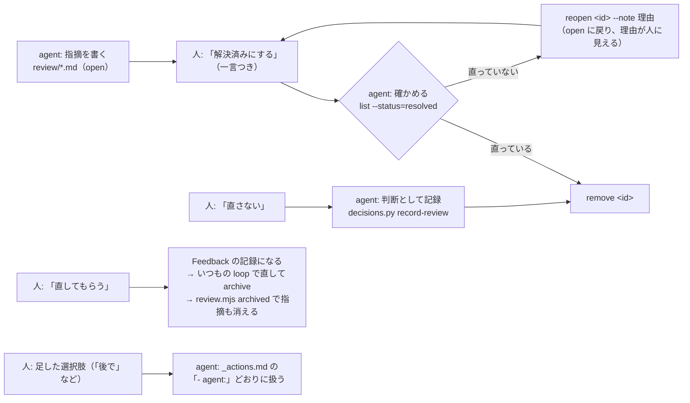

# Review（agent → 人の指摘）: 指摘を画面の上に出し、人はボタンで答える

フィードバック（人 → agent）の逆向き。agent がレビュー・チェックで見つけた指摘を**ファイルに書き**、人は画面（またはチャット）で 1 件ずつ読んで**ボタンで答える**。agent は答えを読んで、確かめて消す・差し戻す・Feedback として直す・判断として記録する。凡例・用語は `references/concepts.md`。

【実績: Web 参照実装】Astro + Starlight の docs サイトで、リリース前チェックの指摘 100 件超を表ではなく「本文の横の印と popup」で人に見せるために作った。表や Markdown のレポートで渡すと読まれない・どこの話か分からない、が出発点。

## 1. いつ使うか

- agent の指摘が多い（10 件超）、または場所（ファイルと行）が大事なとき。表・チャットの箇条書きで渡す代わりにここへ登録する。
- 人に「直す / 直さない / 後で」を決めてもらいたいとき。答えはファイルに残るので、次の回に同じことを聞かずに済む（`decisions.md`）。
- UI（popup）が無くても使える。`scripts/review.mjs` だけで登録・一覧・解決・消去ができ、人の答えをチャットで受けたら agent が `resolve` で書く。UI の作り方は `ui.md`。

## 2. 流れ



- 状態は `open`（既定）と `resolved` の 2 つだけ。どのボタンで解決済みにしたかは `note` の頭（`直さない` / `直さない: <一言>`）で表す。
- **消すのは agent だけ**（`remove`）。人は解決済みにするだけ。agent が確かめずに消してよいのは「直さない」と、`- agent:` にそう書いた選択肢だけ。

## 3. 置き場とファイルの形【実績: Web 参照実装】

置き場は `<Inbox>/review/<まとまりの名前>.md`（Inbox は Feedback と同じ置き場。既定は `$FEEDBACK_DIR`、無ければ `.local/feedback/`）。git に入れない（人の一言が入る、回ごとに作って消す）。1 ファイル = 指摘のまとまり 1 つ（例: `release-check-261109-01.md`）。名前は英数字・`.`・`_`・`-` だけ。例: `assets/templates/review/review-set.example.md`。

```md
---
title: v1.2.0 リリース前チェック 手順 11
base: 1a7a072
---

## [p3] 設定の例が古い書き方のまま
- file: docs/guides/setup.md
- line: 168
- quote: import foo.legacy.Config
- impact: あり: 写すとビルドが失敗する
- recommend: 直してもらう 8, 直さない 2

本文（Markdown）。
- 該当: …
- 直し方の案: …
```

- frontmatter は省略できる。`title` は一覧の表示に、`base` は「行番号を数えたコミット」の表示に使う。
- 指摘 1 件は `## ` の見出しから次の `## ` の手前まで（コードフェンスの中の `## ` は見出しにしない）。
- 見出しの先頭の `[pN]` が優先度（0〜。目安: p7 以上 = 赤、p5〜6 = 橙、p3〜4 = 黄、それ未満 = 灰）。`- priority: N` でもよい。
- **見出しの直後に続く、下の表のキーだけがメタ**。ほかの `- 該当: …` などは本文になる（本文の箇条書きを飲み込まない）。
- **1 件 = 1 か所**。いくつかのファイル・行にまたがる指摘は、場所ごとに 1 件ずつ書く（見出しをそろえ、本文に「同じ指摘: faq.md L140」と添える）。人は場所ごとに直して解決済みにするので、まとめると半分だけ直った状態を表せない。

| キー | 中身 | 書く人 |
|---|---|---|
| `file` | 必須。リポジトリ直下からのパス（`--file-prefix` を決めれば、その下からの省略形でもよい） | agent |
| `line` | `168` / `160-186` / `L160〜L186`。無ければファイル全体への指摘 | agent |
| `quote` | その行に含まれる文字列。**行がずれても quote で探し直す**（いちばん近い行へ動かす）。`…`・`...` は省略。範囲なら先頭の行の文字列。line が無ければ quote を含む最初の行に出す。quote が見つからなければ（line の有無によらず）「もう直っているかも」（`lost`）として `check` に出る | agent |
| `impact` | ユーザ影響の有無。`あり` / `なし`（`yes` / `no` も読む）。後ろに `: 理由`・`（理由）`。プロダクトの利用者に見える・挙動が変わるなら `あり` | agent |
| `recommend` | ボタンごとの推奨度。`直してもらう 8, 直さない 2`（`名前: 8`・`名前 8/10` も読む）。書ける名前は `解決済みにする`・`直さない`・`直してもらう` と人が足した選択肢 | agent |
| `status` / `resolved-at` / `note` | 解決済みの印・時刻・人の一言（頭がボタンの名前） | UI か `review.mjs resolve` |
| `ai-note` | agent の一言（差し戻しの理由）。人に「agent から」として見せる | `review.mjs reopen` |
| `id` | id の固定。同じ file・見出しの指摘がほかにもあるときだけ、解決済みにした・同じ見出しを消した時点で書く。**手では書かない** | `review.mjs` |

**impact と recommend は必ず書く**【実績: Web 参照実装】。人は「利用者に関係あるか」で読む順を決め、推奨度で迷いを減らす（推奨度は agent の見立てで、押すかどうかは人が決める）。`check` は書き漏れを「注意」に出す。

## 4. id【実績: Web 参照実装】

- `<まとまりの名前>/<file と見出しから作る 7 文字>`。ほかの指摘を消しても変わらない（見出しか file を書き換えると変わる）。
- 同じ file・見出しが並ぶと、2 件目から `-2`・`-3`。この番号は並び順なので、前の指摘を消すと `x-2` が `x` に詰まる。**解決済みにした時点と、同じ見出しの指摘を消す時点で、`- id:` を書いて固定する**（`review.mjs` がやる）。Feedback の記録・判断の記録・人に渡したリンクが id で指しているため。
- 手で解決済みにした（`- status:` を手書きした）指摘は固定されていないので、まとめて消すときは**後ろから**消す（`decisions.py record-review` は消す順に `REMOVE <id>` を出す）。

## 5. ボタンと agent の扱い

| ボタン | ファイルに書かれること | agent がすること |
|---|---|---|
| 解決済みにする | `status: resolved`・`note: <一言>` | ソースを見て直っていれば `remove`、直っていなければ `reopen --note "<何が残っているか>"` |
| 直さない | `note: 直さない[: <一言>]` | **確かめずに** `decisions.py record-review` で判断として写し、出た `REMOVE <id>` の順に `remove` |
| 直してもらう | Feedback の記録（`<Inbox>/yymmdd-xx.md`）を作り、`note: Feedback に送った: <記録の id>[ — <一言>]` | Review の流れでは扱わない。記録をいつもの loop で直し、**archive したあとに `review.mjs archived <記録>`** で指摘も消す |
| 人が足した選択肢 | `note: <名前>[: <一言>]` | `review.mjs actions` の `agent:` どおり。`agent:` が無ければ人に聞く。`decision:` があれば `record-review` が判断を写す（消さずに `AGENT <id>` で知らせる）。`agent:` の作業が済んでから `remove` |

- 「直してもらう」の記録は schema 1 の普通の記録（`kind: element`・`source: <file>:<行>`・本文に「直してほしい: <見出し>」と人の一言と指摘の本文、「選んだ位置」に `- Review の指摘: <id>`）。UI が無いときは `review.mjs send <id> --note "<一言>"` で同じものを作れる。
- note の頭は、手で書いた `名前（理由）`・`名前 理由` も同じ名前として読む（参照実装で、手書きの「直さない（理由）」10 件が判断に写らなかった）。

## 6. 人が選択肢を足す（`_actions.md`）【実績: Web 参照実装】

初めからの 3 つのほかに、人が「後で」「このまま」「PR #65 待ち」などを足せる。置き場は `<Inbox>/review/_actions.md`（`_` で始まるので指摘のまとまりとしては読まない）。UI の「＋」で足す・直す・消すか、手で書く。例: `assets/templates/review/actions.example.md`。

```md
## 後で
- agent: 次のバージョンのチケットに積んでから remove する
- decision: 後で

## PR #65 待ち
- agent: PR #65 のマージ後に見直し、箇所が消えていれば remove、残っていれば reopen
```

| キー | 中身 |
|---|---|
| 見出し | ボタンの名前で、`note` の頭に書く文字。20 文字まで。`:` は使えない（`名前: 一言` の区切り）。`直さない`・`直してもらう`・`解決済みにする`・`Feedback に送った` も使えない |
| `agent` | 選ばれた指摘を agent がどう扱うか。UI のボタンの説明と `review.mjs actions` に出る |
| `decision` | 判断の記録（`decisions.md`）に写すときの種類。`直さない` / `このまま` / `後で` / `方針` |

- 8 個まで（ボタンの並びが崩れない数）。見出しの直後に続く `- agent:` / `- decision:` だけを読み、ほかの行はメモとして読み飛ばす。読めない行は `check` に出る。

## 7. cli（`scripts/review.mjs`）

**読解・書き換え・再実装せず、そのまま実行する**（Node 18 以上・依存なし）。入力はオプションか環境変数だけ。

```sh
R="node ${CLAUDE_SKILL_DIR}/scripts/review.mjs"
$R list [--status=open|resolved|all] [--action=<ボタンの名前>] [--impact=あり|なし] [--json]
$R show <id>                         # 1 件の全部。--link のテンプレートがあれば開くリンクも
$R check                             # 登録したら必ず回す。問題があれば NG と終了コード 1
$R resolve <id> [--note "<一言>"]     # 人がチャットで答えたとき（note の頭にボタンの名前を書けば、そのボタンと同じ）
$R remove <id> [--force]             # 解決済みだけ消す。未解決も消すなら --force
$R reopen <id> --note "<理由>"
$R send <id> [--note "<一言>"]        # 「直してもらう」
$R archived <記録の id かパス>        # Feedback の記録を archive したあと
$R actions [--json]
# 共通: --inbox <dir>（$FEEDBACK_DIR）/ --root <dir> / --file-prefix <dir>（$FEEDBACK_FILE_PREFIX）/ --link '<URL>/{file}#review={id}'（$FEEDBACK_REVIEW_LINK）
```

UI の受け口（dev サーバー）は、この script を **import** して同じ関数（`createReviewStore`・`parseReview`・`applyStatus` など）で読み書きする。規則を二重に持たない。書き込みは `<名前>.md.lock` を排他で作ってから行うので、dev サーバーと cli が同時に書いても消し合わない。

## 8. agent の手順

**登録する**

1. 指摘ごとに場所（file・line・quote）を確かめる。quote はその行にある文字列をそのまま写す（言い換えない）。
2. 判断の記録があれば、登録の前に `decisions.py match <ファイル> --drop` で過去と同じ指摘を外す（`decisions.md`）。
3. `impact`・`recommend` を付けて書き、`review.mjs check` が `OK` で、注意が 0 件になるまで直す。
4. 人に渡すのは「何件登録したか」と、UI があれば開く場所（`show` のリンク）だけ。表で中身を繰り返さない。

**答えを処理する**（人が「見た」と言ったとき、または loop のついで）

1. `review.mjs actions` で選択肢の扱いを読む。
2. `decisions.py record-review <ファイル> --decided "<日付 回>"` → 「直さない」と、decision の付いた選択肢の判断が写る。出た `REMOVE <id>`（直さない）を出た順に `remove`。`AGENT <id>`（人が足した選択肢）はまだ消さない。
3. `list --status=resolved --action=<名前>` で選択肢ごとに拾い、`agent:` どおりに扱う（チケットに積む・PR を待つなど）。その作業が済んでから `remove`（`agent:` が「見直して残っていれば reopen」なら `reopen`）。
4. 残りの解決済み（ボタンの名前で始まらない一言）は、ソースを見て直っていれば `remove`、残っていれば `reopen --note`。
5. 「Feedback に送った」は触らない（loop の側で archive → `archived`）。

## 9. 汎用化で足したこと・未検証【追加】

- 参照実装は docs サイト（Astro + Starlight）の指摘だけ。アプリのコード（`.kt`・`.swift` など）への指摘も同じ形で書けるが、UI（コードの上に印を出す）は未検証。エディタの拡張・GitHub の PR コメントに出す形も未検証。
- `review.mjs` の `resolve`・`send` は参照実装では UI からだけ呼んでいた。cli から呼ぶ形は汎用化で足した（テストは `scripts/review.test.mjs`）。
- ページのパスとソースの対応（`#review=<id>` で開くリンク）は導入先ごとに違うので、`--link` のテンプレートにした。
