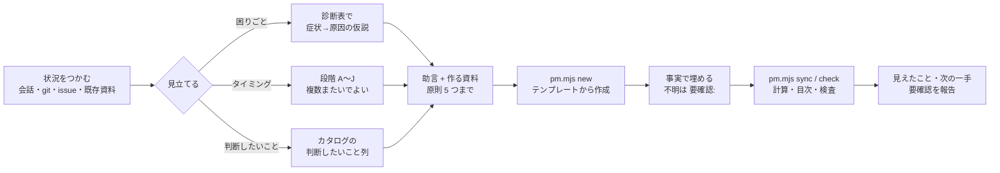

# pm

**プロジェクトの困りごとを診断して助言し、判断に効く資料だけを作る**スキル。
「なんかうまく行ってない」「今から立ち上げる」「リリースしていい？」のどれから話し始めてもよい。

資料を作ること自体は目的ではない。何を可視化すればどの判断ができるようになるかから資料を選び、
助言だけで足りるなら資料は作らない。

## インストール

```sh
gh skill install tbsten/skills pm
```

## 使い方

```text
User: /pm なんかよく分からんけど、プロジェクトの運用がうまく行ってない

AI:   見立て: 仕様追加の承認経路が曖昧で、変更の影響を見ずに受けているため手戻りが続いている。
      iOS が 1 人に集中していて、止まると全体が止まる。…
      今日からできること: 追加要求は影響を表にしてから受ける / 決定ごとに最終責任者を 1 人決める …
      以下を作りながら状況を整理する:
        1. 変更影響分析表 — SNS ログインを入れるかを判断できる
        2. RACI マトリクス — 誰が決めるかを判断できる
        3. ADR — 同じ議論を繰り返さない
```

```text
User: /pm 今からプロジェクト立ち上げる。MVP の範囲もまだ決めてない

AI:   立ち上げ (A) と範囲決め (B) にまたがる状況として、以下を作りながら整理する:
        1. プロジェクト憲章  2. スコープ定義書  3. ユーザーストーリーマップ  4. 優先順位マトリクス
```

## 流れ



## 資料カタログ

IPA プロジェクトマネージャ試験シラバス Ver.7.1 をベースに、モバイル・Web アプリ開発で必要になるタイミングで並べ直した 46 種。
ストーリーマップ・ADR・カンバン・段階的ロールアウトなど、現代的なソフトウェア開発の手法も補っている。

| タイミング | 中心の資料 | ほかの資料 |
|---|---|---|
| A. プロジェクトを立ち上げる | プロジェクト憲章、ゴールツリー | ステークホルダマップ |
| B. 開発範囲を決める | スコープ定義書、ユーザーストーリーマップ | 要求トレーサビリティマトリクス、優先順位マトリクス |
| C. 開発計画を立てる | ロードマップ、WBS、工数・コスト見積り表 | ガントチャート、クリティカルパス、リソースヒストグラム、PM 計画書 |
| D. チームで開発を進める | RACI、コミュニケーション計画書 | スキルマトリクス、カンバン、バーンダウン、EVM |
| E. リスクや不確実性に備える | リスク登録簿、リスクマトリクス | コンティンジェンシー計画、PoC 計画書 |
| F. 変更や問題に対応する | 変更影響分析表、ADR、課題管理表 | 依存関係図、選択肢評価表、特性要因図 |
| G. 品質を管理する | 品質計画書、テスト戦略図 | 品質ダッシュボード、パレート図、管理図 |
| H. 外部サービス・委託先を管理する | Make or Buy 分析、外部依存台帳 | RFP |
| I. リリースする | リリース計画、Go / No-Go チェックリスト | 互換性マトリクス、運用引継ぎ資料 |
| J. プロジェクトを評価する | 成果評価レポート、KPT | 終結報告書、教訓登録簿 |

各資料には「判断したいこと」（例: 何が遅れるとまずい？ → クリティカルパス）が付いている。
一覧は `node scripts/pm.mjs list` で見られる。

## 生成されるもの

既定では `docs/pm/` に次を作る（`--dir` で変更できる）。

- `<id>-<slug>.md` — 資料 1 つにつき 1 ファイル。表と Mermaid 図で書く
- `README.md` — タイミング別の目次。残 TODO・要確認の数と、要確認（未決の問い）の一覧を `pm.mjs sync` が生成する

分からないことは数字や名前を作らず `要確認: <問い>` と書く。
最後にこの問いの一覧が渡されるので、答えればそのまま資料に反映できる。

## script が受け持つこと

AI の判断を減らすため、決定的な作業は `scripts/pm.mjs` が行う。

| コマンド | 内容 |
|---|---|
| `phases` / `list` | タイミングとカタログの表示 |
| `new` | テンプレートから資料を作る（既存は上書きしない） |
| `sync` | 計算ブロックの再計算・更新日の反映・目次の再生成 |
| `status` | 作った資料と残 TODO・要確認の数 |
| `check` | TODO の残り・計算の古さ・コードブロックの閉じ忘れを検査。`--render` で Mermaid を実際に描画して確かめる |

次の 6 種の資料は、表を埋めて `sync` すると計算結果と図が書き込まれる。

| 資料 | 計算 |
|---|---|
| ネットワーク図・クリティカルパス | 最早・最遅開始、余裕、最短期間、クリティカルパスと図 |
| 工数・コスト見積り表 | 三点見積り（PERT）と σ、合計 |
| EVM チャート | SV・CV・SPI・CPI、BAC があれば EAC・VAC と図 |
| 選択肢評価表 | 重み付き合計・順位と図 |
| パレート図 | 件数順の並べ替え・累積割合・累積 80% の分類と図 |
| 管理図 | 平均・管理限界（± 3σ）・限界外の点・片側 7 点連続と図 |

## 関連するスキル

- 今の作業の詰まりを 1 枚の図で見たいだけなら [status-board](./status-board.ja.md)
- 作業をチケットに落として管理するなら [local-ticket-system](./local-ticket-system.ja.md)

## 検証状況

- Claude Code 2.1.332 で 3 つの場面（困りごと相談・立ち上げ・見積りとクリティカルパス）を実行し、資料の作成から `check` の通過まで確かめた（`skills/pm/evals/` の 3 ケース）
- 46 種のテンプレートと計算結果の Mermaid 図（21 図）を mermaid-cli 11.17.1 で描画できることを確かめた

## 必要なもの

- Node.js 18 以上（`scripts/pm.mjs` の実行）
- `check --render` を使うときは、初回に npx で `@mermaid-js/mermaid-cli` を取得する
