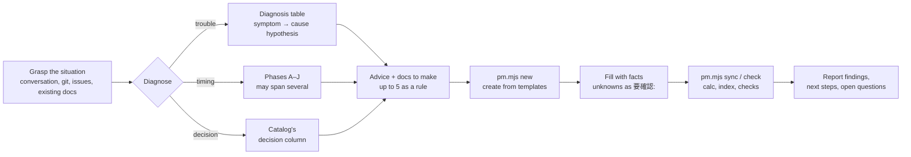

# pm

**A skill that diagnoses project trouble, gives advice, and creates only the documents that help you decide.**
You can start from "something is off", "we are kicking off a project", or "can we release?".

Making documents is not the goal. Documents are chosen by asking what to make visible so that a decision becomes possible.
If advice alone is enough, no documents are created.

## Install

```sh
gh skill install tbsten/skills pm
```

## Usage

```text
User: /pm I can't put my finger on it, but the project isn't running well

AI:   Diagnosis: scope additions are accepted without a clear approver or impact check, so rework keeps happening.
      iOS knowledge sits with one person, so everything stops when they are away. ...
      What you can do today: assess the impact of a request before accepting it / name one accountable person per decision ...
      I'll sort the situation out while creating:
        1. Change impact analysis — decide whether to add SNS login
        2. RACI matrix — decide who decides
        3. ADR — stop repeating the same discussion
```

```text
User: /pm We're starting a project now. The MVP scope isn't decided yet either

AI:   This spans kickoff (A) and scoping (B). I'll sort it out while creating:
        1. Project charter  2. Scope statement  3. User story map  4. Impact / effort matrix
```

## Flow



## Document catalog

46 documents based on the IPA Project Manager Examination syllabus Ver.7.1, reorganized by when they are needed in mobile / web app development.
Modern practices such as story maps, ADRs, kanban, and staged rollouts are added as well.

| Timing | Core documents | Other documents |
|---|---|---|
| A. Kick off the project | Project charter, goal tree | Stakeholder map |
| B. Define the scope | Scope statement, user story map | Requirements traceability matrix, impact / effort matrix |
| C. Plan the work | Roadmap, WBS, effort and cost estimate | Gantt chart, critical path, resource histogram, PM plan |
| D. Run the team | RACI, communication plan | Skill matrix, kanban, burndown, EVM |
| E. Prepare for risk and uncertainty | Risk register, risk matrix | Contingency plan, PoC plan |
| F. Handle changes and problems | Change impact analysis, ADR, issue log | Dependency map, decision matrix, fishbone diagram |
| G. Manage quality | Quality plan, test strategy | Quality dashboard, Pareto chart, control chart |
| H. Manage external services and vendors | Make-or-buy analysis, supplier register | RFP |
| I. Release | Release plan, Go / No-Go checklist | Compatibility matrix, operations handover |
| J. Evaluate the project | Benefits realization report, KPT | Closure report, lessons learned register |

Each document has a "decision it supports" (e.g. what delays would hurt? → critical path).
Run `node scripts/pm.mjs list` to see the list.

## Output

By default the skill creates the following in `docs/pm/` (change it with `--dir`).

- `<id>-<slug>.md` — one file per document, written with tables and Mermaid diagrams
- `README.md` — an index by timing, generated by `pm.mjs sync`, with remaining TODO / open question counts and the list of open questions

Unknown facts are never invented. They are written as `要確認: <question>`.
The list of these questions is handed to you at the end, and your answers can go straight into the documents.

## What the script handles

To reduce AI judgment, deterministic work is done by `scripts/pm.mjs`.

| Command | What it does |
|---|---|
| `phases` / `list` | Show the timings and the catalog |
| `new` | Create documents from templates (never overwrites) |
| `sync` | Recalculate calc blocks, update dates, regenerate the index |
| `status` | Created documents with remaining TODO / open question counts |
| `check` | Check leftover TODOs, stale calculations, and unclosed code blocks. `--render` actually renders Mermaid |

For the following 6 documents, fill the table and run `sync` to get results and diagrams written in.

| Document | Calculation |
|---|---|
| Network diagram / critical path | Earliest / latest start, float, shortest duration, critical path and diagram |
| Effort and cost estimate | Three-point (PERT) estimate, σ, and total |
| EVM chart | SV, CV, SPI, CPI, plus EAC and VAC when BAC is given, with a chart |
| Decision matrix | Weighted totals, ranking, and chart |
| Pareto chart | Sorting by count, cumulative share, the categories up to 80%, and chart |
| Control chart | Mean, control limits (± 3σ), points outside, runs of 7 on one side, and chart |

## Related skills

- To see current bottlenecks in one diagram, use [status-board](./status-board.md)
- To manage work as tickets, use [local-ticket-system](./local-ticket-system.md)

## Verification

- Ran 3 scenarios (vague trouble, kickoff, estimate and critical path) with Claude Code 2.1.332 and confirmed everything from document creation to a passing `check` (the 3 cases in `skills/pm/evals/`)
- Confirmed that all 46 templates and the Mermaid diagrams written by calculations (21 diagrams) render with mermaid-cli 11.17.1

## Requirements

- Node.js 18 or later (to run `scripts/pm.mjs`)
- `check --render` fetches `@mermaid-js/mermaid-cli` via npx on first use
