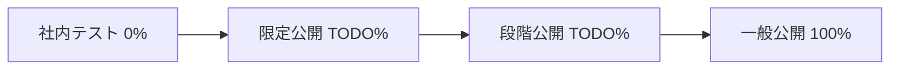

# リリース計画・段階的ロールアウト図

> 判断したいこと: どう段階的に出す？

| 段階 | 対象 | 期間 | 次へ進む条件 | 異常時の対応 |
|---|---|---|---|---|
| 社内テスト | TODO | TODO | TODO | TODO |
| 限定公開 | TODO | TODO | TODO: 例: クラッシュ率が目標内 | TODO: 展開停止 / 機能フラグで無効化 |
| 段階公開 | TODO | TODO | TODO | TODO |
| 一般公開 | 全ユーザー | - | - | TODO |
