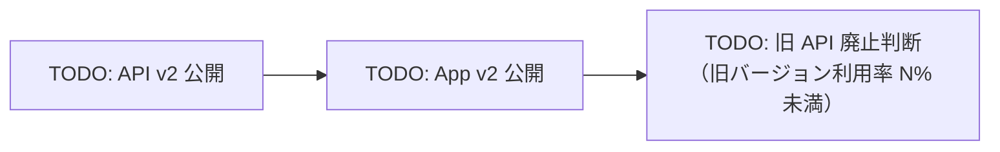

# 移行・互換性マトリクス

> 判断したいこと: どの順で出せば壊れない？

| クライアント \ サーバー | TODO: API v1 | TODO: API v2 |
|---|---|---|
| TODO: App v1.0 | 互換あり | TODO |
| TODO: App v2.0 | TODO | 互換あり |

## リリース順序

- 強制アップデートの条件: TODO
