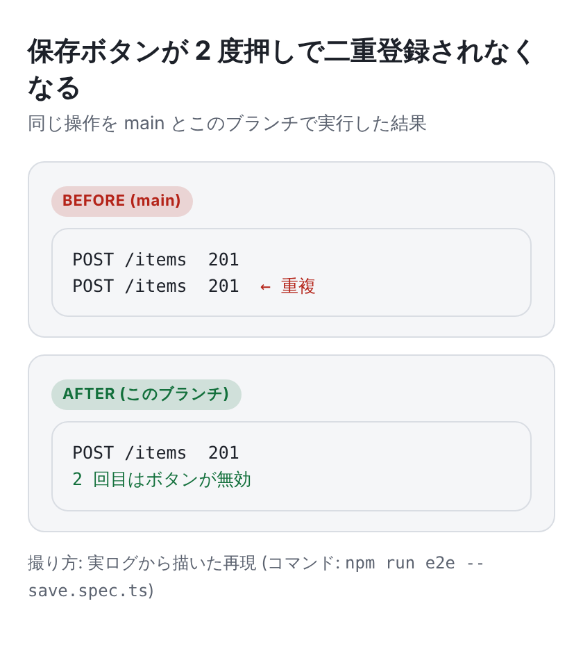

# visual-explanation

[English](./visual-explanation.md)

**人間に見せる説明には、最初の 1 枚で要点が分かるものを付ける**スキル。PR の本文・チケット
(GitHub issue / Notion / Linear など) の説明・レポートに、文章を読む前に分かる図・スクショ・実際の出力を付ける。



## インストール

```sh
gh skill install tbsten/skills visual-explanation
```

方針 (いつ・何を見せるか) を持つ [`visual-explanation` rule](../rules/visual-explanation.ja.md) と組み合わせて使う。
rule はどのセッションでも読まれる:

```sh
curl -fsSL https://rules.tbsten.me/i | bash -s -- visual-explanation
```

## rule と skill に分けている理由

| 中身 | 種類 | 理由 |
|---|---|---|
| 変更の種類ごとの見せ方・作り方・画像の置き場所 | rule | 頼まれなくても、どのセッションでも効いてほしい |
| HTML 雛形・撮影・PR への添付・本文の検証 | skill (`scripts/`) | 毎回同じ手順なので、文章でなく script にする |
| PR テンプレートへの枠の追加 | skill のセットアップ | 既存テンプレートとのマージは判断が要る。rule のインストーラだと上書きしてしまう |

元のキットは、この運用が Claude のプロジェクトメモリにしか無かったプロジェクトから持ち出したもの。
メモリが無いと止まってしまったので、リポジトリに書く形にしている。

## 流れ

| ステップ | やること |
|---|---|
| セットアップ (1 回) | rule を入れ、`scripts/setup-pr-template.sh` で PR テンプレートを作る (既存があれば足す snippet を出す) |
| 1. 選ぶ | `references/formats.md` から見せ方を選ぶ (Before / After・タイムライン・1 枚まとめ・GIF・diff・`<details>` の出力・なし) |
| 2. 描く | `assets/template.html` をリポジトリの外にコピーし、1 枚ごとに `<section id>` を書く。中身は実際の実行・実データから |
| 3. 撮る | `scripts/capture.mjs` が section ごとにライト / ダークを幅 420px・scale 3 で撮る |
| 4. 添付する | `scripts/attach-pr-assets.sh` が画像を `.github/pr-assets/` にコミットし、次のコミットで消し、SHA 固定 URL を出す (公開: `raw.githubusercontent.com`、非公開: `blob/<sha>/...?raw=true`) |
| 5. 検証する | `scripts/check-body.mjs` が、見た目が無い・alt が無い (ファイル名のまま)・URL がブランチ名・URL の形が混在、を NG にする |

## Scripts

| script | 入力 | 出力 |
|---|---|---|
| `capture.mjs <html> <out-dir> [--width] [--scale] [--schemes]` | `<section id>` を持つ HTML | `OK` + PNG の JSON 一覧 |
| `attach-pr-assets.sh [--visibility] [--push] <file>...` | PNG (PR ブランチで実行) | `OK`・SHA・Markdown の画像行 |
| `setup-pr-template.sh [<repo-root>]` | リポジトリ | テンプレートごとに `CREATED` / `ALREADY` / `NEEDS_MERGE` (`PULL_REQUEST_TEMPLATE/` ディレクトリも対象) + snippet |
| `check-body.mjs [--no-visual] <body.md \| ->` | PR / チケットの本文 | `OK` か `NG:` 行 (終了コード 1) |

`attach-pr-assets.sh` は `main` / `master` / `develop`・detached HEAD・他にステージ済みの変更がある・ファイル名に `[A-Za-z0-9._-]` 以外がある・入力同士や `.github/pr-assets/` の既存ファイルと名前が衝突する、のどれかなら実行を断る。
CI だけ・設定だけの変更 (見せ方の表で画像なしでよいもの) は `check-body.mjs` に `--no-visual` を付ける。
`capture.mjs` には Playwright が要る (Claude Code のクラウド環境には入っている。手元なら
`npm i -D playwright && npx playwright install chromium`)。

## ファイル

```
visual-explanation/
├── SKILL.md
├── references/formats.md            # 見せ方の表と雛形の部品の対応
├── assets/
│   ├── template.html                # ライト / ダークのトークン・比較・タイムライン・コード
│   └── pull_request_template.md     # setup-pr-template.sh が使う
└── scripts/
    ├── capture.mjs
    ├── attach-pr-assets.sh
    ├── setup-pr-template.sh
    └── check-body.mjs
```
