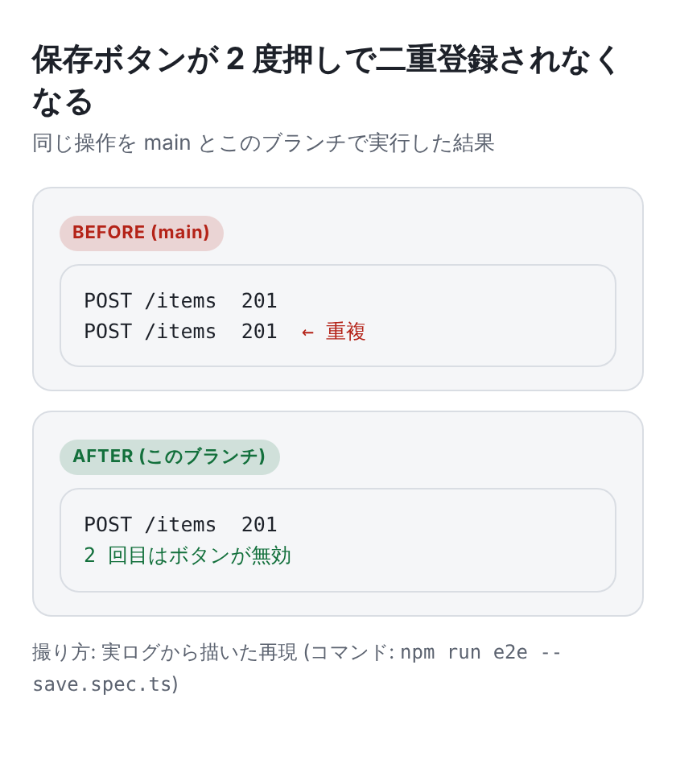

# visual-explanation

[Japanese](./visual-explanation.ja.md)

**Give every human-facing explanation a first image that tells the story.** PR descriptions, ticket
descriptions (GitHub issues / Notion / Linear) and reports get a diagram, screenshot or real output
that the reader can grasp before reading any prose.



## Install

```sh
gh skill install tbsten/skills visual-explanation
```

Pair it with the [`visual-explanation` rule](../rules/visual-explanation.md), which holds the
policy (when and what to show) and is loaded in every session:

```sh
curl -fsSL https://rules.tbsten.me/i | bash -s -- visual-explanation
```

## Why a rule and a skill

| Part | Kind | Why |
|---|---|---|
| What to show for each kind of change, how to make it, where images live | rule | Must apply in every session, even when nobody remembers to ask |
| HTML template, screenshots, attaching to a PR, checking the body | skill (`scripts/`) | Deterministic steps, so they are scripts instead of prose |
| Adding a slot to the PR template | skill setup step | Merging into an existing template needs judgment; the rule installer would overwrite it |

The kit was extracted from a project where the practice lived only in Claude's project memory. When
that memory was missing the practice stopped, so this version writes it into the repository.

## Workflow

| Step | What happens |
|---|---|
| Setup (once) | Install the rule, then `scripts/setup-pr-template.sh` creates a PR template or prints the snippet to merge into the existing one |
| 1. Choose | Pick a format from `references/formats.md` (Before / After, timeline, one-page summary, GIF, diff, `<details>` output, or nothing) |
| 2. Draw | Copy `assets/template.html` outside the repo and write one `<section id>` per image, from real runs and data |
| 3. Capture | `scripts/capture.mjs` screenshots each section in light and dark at 420px wide, scale 3 |
| 4. Attach | `scripts/attach-pr-assets.sh` commits the images to `.github/pr-assets/`, removes them in the next commit, and prints SHA-pinned URLs (public: `raw.githubusercontent.com`, private: `blob/<sha>/...?raw=true`) |
| 5. Check | `scripts/check-body.mjs` fails when the body has no visual, an image has no alt (or a file-name alt), a URL is pinned to a branch instead of a SHA, or URL styles are mixed |

## Scripts

| Script | Input | Output |
|---|---|---|
| `capture.mjs <html> <out-dir> [--width] [--scale] [--schemes]` | HTML with `<section id>` | `OK` + JSON list of PNGs |
| `attach-pr-assets.sh [--visibility] [--push] <file>...` | PNG files, run on a PR branch | `OK`, the SHA, Markdown image lines |
| `setup-pr-template.sh [<repo-root>]` | repository | `CREATED` / `ALREADY` / `NEEDS_MERGE` per template (incl. `PULL_REQUEST_TEMPLATE/` dirs) + snippet |
| `check-body.mjs [--no-visual] <body.md \| ->` | PR / ticket body | `OK` or `NG:` lines (exit 1) |

`attach-pr-assets.sh` refuses to run on `main` / `master` / `develop`, on a detached HEAD, with
other staged changes, with file names outside `[A-Za-z0-9._-]`, or when a name collides with an input
or an existing file in `.github/pr-assets/`. Pass `--no-visual` to `check-body.mjs` for CI-only or
config-only changes, where the format table allows no image. `capture.mjs` needs Playwright (pre-installed in Claude Code cloud sessions;
locally run `npm i -D playwright && npx playwright install chromium`).

## Files

```
visual-explanation/
├── SKILL.md
├── references/formats.md            # format table and matching template parts
├── assets/
│   ├── template.html                # light / dark tokens, compare, timeline, code
│   └── pull_request_template.md     # used by setup-pr-template.sh
└── scripts/
    ├── capture.mjs
    ├── attach-pr-assets.sh
    ├── setup-pr-template.sh
    └── check-body.mjs
```
